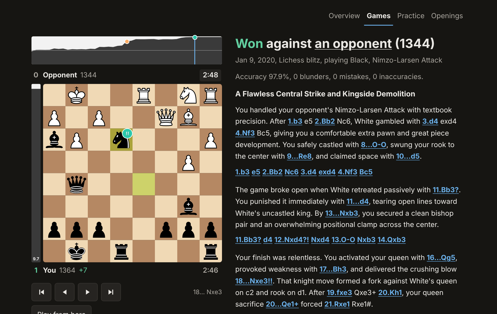
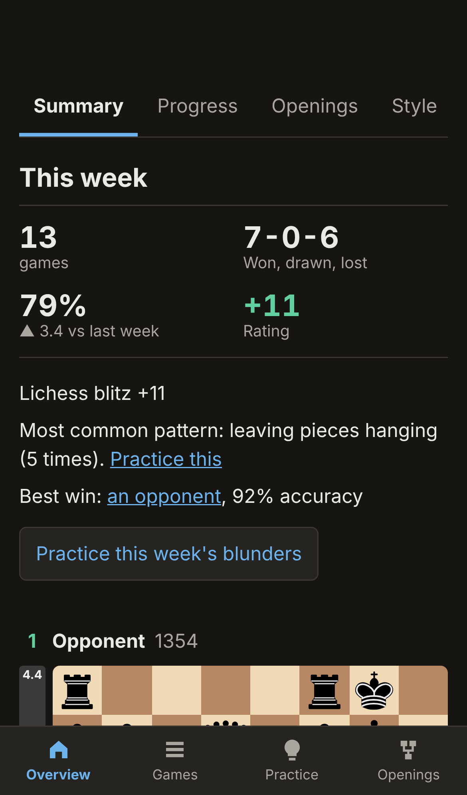

# pinkroses-lichess

An automated pipeline that has reviewed over 11,000 of my chess games with Gemini and Claude and checks each review against the board.

Tracks every game I play on Lichess and Chess.com, checks each one with Stockfish, and publishes a written review of it, along with rating trends and recurring mistakes, as a GitHub Pages site.

**Live site:** https://kennethkimbrough.github.io/pinkroses-lichess/



## Highlights

- **Runs unattended:** a scheduled GitHub Action fetches, analyses, reviews and publishes new games, with no server to maintain.
- **Checks the AI's work:** a review is rejected if it cites a move or tactic the board doesn't support.
- **Controls spending:** monthly and total limits are checked before each review, and interrupted work picks up on the next run.
- **Combines two sites:** Lichess and Chess.com games share one data format, one set of analysis and one site.
- **Tested:** 61 automated tests cover the tracker.



## How it works

Every two hours a GitHub Action:

1. Downloads new games from the public Lichess and Chess.com APIs.
2. Runs Stockfish 17.1 on each position (100,000 nodes) to find mistakes, blunders and the moves the engine preferred.
3. Sends the annotated game to `google/gemini-3.7-flash` through OpenRouter for a review of how the game unfolded. Another 999 reviews were written by Claude Sonnet 5.5 during a trial and imported. A review is rejected and retried if it cites a move that isn't in the game or an engine line, or names a pin, skewer, fork, discovered attack or back-rank tactic the board doesn't show. Reviews cover the latest 50 games at setup, every game after them, all rapid and classical games, and all human Chess.com games. Bot games are analysed but not reviewed or counted in stats.
4. Commits the results to `data/` and publishes the site from `site/`.

While work remains, each productive run queues the next one, so backlogs don't depend on the schedule. A run with no new games changes nothing and costs nothing. Variants, games under 4 half-moves and games whose reviews keep failing are kept in `data/` but left off the site. Older games are analysed newest first across runs and count toward the stats. If the repo has been quiet for 50 days, a small commit keeps the schedule from being disabled.

In the move table, `!!` marks a brilliant move and `!` marks a great move: the engine's top move, when the second-best move is already losing. Forced moves and plain recaptures don't count.

Other labels come from the drop in win chance: Best (under 1%), Excellent (under 2.5%), Good (under 5%), plus Book for positions in the [Lichess opening list](https://github.com/lichess-org/chess-openings) (CC0) and Miss for failing to punish an error or missing a forced mate without ending up lost. They resemble Chess.com's labels but won't always match them.

"Played most like" scores each game's move patterns, such as captures, pawn play, castling and pressure on the king, against 16 of the 18 undisputed champions, using a linear model trained on up to 1,200 games each from PGN Mentor files in the [Chess-Dataset collection](https://github.com/mainali123/Chess-Dataset). In a held-out test it picked the right champion 17% of the time on average, against 6% by chance, so treat it as a fun comparison. Fast online games also lean toward the sharper, older champions, partly because of how they're played. Ding Liren and Gukesh Dommaraju aren't in that data. `tools/build_champion_profiles.py` rebuilds the model and needs numpy.

A brilliant move here is a sacrifice: the engine's top move that leaves a knight or bigger piece where something cheaper can legally take it at a net loss, without losing ground. It isn't the same as Lichess or Chess.com move labels.

Accuracy follows the Lichess method, but on separate engine analysis, so it can differ slightly from the figure Lichess shows.

## On the site

- **Game pages:** written reviews with clickable moves, an evaluation graph with markers, a move table, better-move arrows and each player's remaining time.
- **Interactive board:** tap or drag pieces to try your own lines, analyse them with Stockfish in the browser, or play on against the computer from any position.
- **Practice:** positions from past blunders, with streaks and spaced repeats. Progress is saved per browser.
- **Games list:** search, sort and filter by site, time control, result, rating, date or closest world champion.
- **Insights:** progress toward the rating goal, an opening explorer, clock analysis, playing style and opponent pages.
- **Phone support:** a bottom navigation bar, and the site can be added to the home screen with its own icon.

## Setup

1. Add an `OPENROUTER_API_KEY` repository secret, ideally from a key with its own spending limit.
2. Set **Settings > Pages > Source** to **GitHub Actions**.
3. Run **Update games** from the Actions tab, or wait for the schedule.

## Settings

All of these are in `config.json`:

| Setting | Meaning |
|---|---|
| `reviews_enabled` | Turns ongoing reviews on or off. |
| `review_latest` | How many recent games to review when reviews first start. |
| `review_all_speeds` | Time controls to review across the full history. |
| `full_history_stop_at_usd` | Older games are reviewed until total spending reaches this amount, which leaves money for new games. |
| `monthly_limit_usd` | Pauses reviews until next month after this much spending. |
| `monthly_limit_overrides` | A different limit for a named month, such as `2026-11`. |
| `max_cost_usd` | Stops reviews once total tracked spending reaches this amount. |
| `reasoning` | Extra model reasoning: `off`, `low`, `medium` or `high`. |
| `chesscom_reviews_enabled` | Turns reviews on for human Chess.com games. |
| `chesscom_bots`, `chesscom_humans` | Opponent names to force as bots or humans. |
| `model` | Any OpenRouter model id. |
| `engine_nodes` | Stockfish search size per position. |
| `goal_rating` | The target shown on the site. |

## Run it locally

```sh
pip install -r requirements.txt pytest
pytest
STOCKFISH_PATH=/path/to/stockfish OPENROUTER_API_KEY=... python -m tracker run --minutes 10
python -m tracker build
python -m http.server --directory site
```

Live analysis on the site runs [Stockfish.js](https://github.com/nmrugg/stockfish.js) 19 Lite in the browser, with a slower compatibility build as a fallback (GPLv3, see `site/vendor/stockfish`). Board pieces are the cburnett set by Colin M.L. Burnett (GPLv2+, see `site/vendor/pieces`). Board replay uses [chess.js](https://github.com/jhlywa/chess.js) (BSD 2-Clause, see `site/vendor`).

## License

Copyright (C) 2026 Kenneth Kimbrough. This project is licensed under the [GNU General Public License v3.0](LICENSE).

Bundled in `site/vendor`, each under its own license:

- [Stockfish.js](https://github.com/nmrugg/stockfish.js): GPLv3, see `site/vendor/stockfish/COPYING.txt`.
- Chess pieces by Colin M.L. Burnett (cburnett): see `site/vendor/pieces/LICENSE.txt`.
- [chess.js](https://github.com/jhlywa/chess.js): see `site/vendor/chess.js.LICENSE`.
